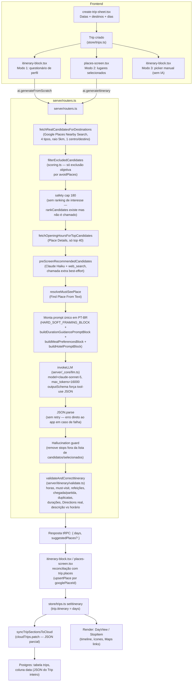

# Auditoria técnica — Motor de geração de roteiros (LocalsApp)

> **[HISTÓRICO — pré-migração]** Esta auditoria descreve o motor de roteiros como ele era **antes** da migração para OpenAI (`server/_core/llm.ts`) e Google Routes API (`server/itinerary/routes.ts`), realizada na mesma branch `teste` logo após esta auditoria ter sido escrita. Todas as referências a Anthropic/Claude e à Google Directions como provedor **principal** de tempo de viagem abaixo refletem esse estado anterior — ver `server/README.md` e `server/itinerary/routes.ts` para o comportamento atual. Mantido como registro histórico das decisões/achados originais; não usar como documentação do estado atual.

> Auditoria somente leitura, branch `teste`, realizada em 2026-10-18. Todas as afirmações marcadas **[CONFIRMADO]** vêm de leitura direta do código listado (caminho + comportamento real). Afirmações marcadas **[PROPOSTO]** são recomendações desta auditoria, ainda não implementadas. Afirmações marcadas **[SUPOSIÇÃO]** são hipóteses plausíveis que o repositório não permite confirmar sozinho (precisam de teste em produção/profiling).

---

## 1. Resumo executivo

O LocalsApp gera roteiros dia-a-dia via três entradas de produto que convergem em dois procedures tRPC no backend (`ai.generateFromScratch` e `ai.generateItinerary`, em `server/routers.ts`), que montam um prompt em português, chamam a Anthropic API uma única vez com saída forçada por JSON Schema, e depois passam o resultado por uma camada determinística de validação/correção (`server/itinerary/validate.ts`) antes de devolver ao app.

Principais achados **confirmados no código** (detalhados nas seções 3, 5 e 7):

1. **O catálogo curado (`server/catalog.ts`, alimentado por `curate:import`/`curate:redescribe`) não é usado pela geração de roteiro.** Ele só alimenta `ai.suggestPlaces` (a aba "Lugares"). Se o usuário não clicar manualmente em "sugerir lugares" e selecionar algo antes de gerar o roteiro, toda a curadoria editorial é ignorada e o preenchimento de lugares vem 100% do Google Places Nearby Search genérico, ordenado por número de avaliações (popularidade pura). Isso é uma causa direta e verificável de "restaurantes mal selecionados / bons lugares locais omitidos".
2. **Existe um módulo de ranking por interesse do viajante totalmente implementado e testado (`server/itinerary/scoring.ts`, `rankCandidates`/`scoreCandidate`) que nunca é chamado em produção.** Só é usado em `tests/itinerary-engine.test.ts`. Em `server/routers.ts` apenas `filterExcludedCandidates` (o filtro objetivo de exclusão) é importado e usado — o ranking por interesse/qualidade é código morto.
3. **Não existe nenhum algoritmo de clustering geográfico ou distribuição diária.** A única instrução de agrupamento geográfico é uma frase no prompt ("agrupe por proximidade geográfica... minimizando deslocamentos"). O validador determinístico só ordena paradas cronologicamente dentro do dia — nunca reordena por geografia. Isso explica diretamente o backtracking geográfico relatado.
4. **Campos ricos do perfil do viajante existem no schema Zod e são usados na construção do prompt, mas nunca são preenchidos pela UI**: `preferences.mustSee` (texto livre), `preferences.avoidPlaces`, `preferences.mealPreferences` no fluxo "do zero" (`components/trip/itinerary-block.tsx`), e praticamente **todas** as preferências (pace real, horários, orçamento, transporte, hospedagem) no fluxo "com lugares selecionados" (`components/trip/places-screen.tsx`, linha 906, hardcoda `{ pace: 'moderado', includeBreakfast: true, includeLunch: true, includeDinner: true }`). O próprio código documenta isso em `types/voyage.ts:336-338`: *"No UI surface yet — added so the backend can already accept and act on these when a future UI adds the corresponding selectors."*
5. **A cobertura de horário de funcionamento real é parcial por desenho**: `fetchOpeningHoursForTopCandidates` busca Place Details (que inclui `opening_hours`) só para os 40 primeiros candidatos de um pool que pode ter até 180 (`CANDIDATE_SAFETY_CAP = 180`). Para os demais ~140, `hoursByPlaceId` nunca é preenchido, e o validador trata "sem dados" como "não bloquear" (`validate.ts:319`, comentário explícito: *"unparsable — don't block on it"*). O modelo pode escalonar esses lugares em qualquer horário sem que a camada determinística detecte.
6. **Não há retry automático nem reparo de JSON inválido** nos dois endpoints de geração: se `JSON.parse(content)` falhar, o backend lança `TRPCError INTERNAL_SERVER_ERROR` direto para o app, e cabe ao usuário tocar em "gerar" de novo manualmente. A saída é forçada via tool-use (JSON Schema), o que reduz bastante o risco de JSON malformado, mas não cobre timeout, resposta vazia ou campos fora do schema.
7. **Operações sequenciais que poderiam ser paralelas**: o passo 9 do validador (`validate.ts:488-502`) chama `await ctx.fetchTravel(...)` dentro de um `for` duplamente aninhado (dia × parada), uma Directions API call por vez, em série. Para uma viagem de 7 dias com ~5 paradas/dia isso pode ser ~30 chamadas HTTP sequenciais só nessa etapa.
8. **Modelo**: `ENV.anthropicModel` tem fallback `"claude-sonnet-5"` (`.env` tem `ANTHROPIC_MODEL=` vazio, então usa o default) para a geração principal; chamadas auxiliares (pré-seleção com busca web, tradução) usam `claude-haiku-4-5-20251001` explicitamente. A geração principal roda **sem `timeoutMs` configurado** (usa o timeout default do SDK Anthropic), diferente da chamada de fallback de `suggestPlaces` que define 25s.

Este documento cobre o fluxo ponta a ponta, inventaria todas as integrações de dados, documenta a estratégia de prompt atual, faz o diagnóstico causa-raiz de cada problema relatado, audita o contrato de dados da UI, e propõe uma arquitetura mínima de melhoria — respeitando explicitamente a decisão de produto de que **filtragem subjetiva de qualidade não deve excluir candidatos silenciosamente**, apenas reordenar/priorizar.

---

## 2. Fluxo de geração existente

Existem **três entradas de produto** diferentes para chegar a um roteiro, todas documentadas em `todo.md` (Fase 14 — "Redesign do Sistema de Roteiro"):

- **Modo 1 — "IA do zero"**: questionário de perfil (`components/trip/itinerary-block.tsx`, modal `showProfileModal`) → `ai.generateFromScratch`.
- **Modo 2 — "IA organiza com meus lugares"**: usuário já salvou lugares na aba Lugares → `components/trip/places-screen.tsx:887` (`handleGenerateItinerary`) → `ai.generateItinerary`.
- **Modo 3 — Manual**: usuário monta o roteiro sem IA, usando os pickers de dia (`itinerary-block.tsx`, `showManualPicker`) — não passa por nenhum LLM.



Observação: `ai.suggestPlaces` (catálogo curado + fallback Google+IA) é uma etapa **anterior e opcional** que só alimenta a lista de "lugares disponíveis" na aba Lugares — não é chamada pelos dois endpoints de geração de roteiro em nenhum ponto do código. A única forma de o catálogo curado influenciar o roteiro é indiretamente: usuário aceita uma sugestão do catálogo em Lugares → ela se torna um `Place` salvo → ela entra em `selectedPlaces` quando o Modo 2 ou Modo 1 (com `profileConsiderSelectedPlaces=true`) roda.

---

## 3. Mapa de implementação arquivo a arquivo

### 3.1 Receber pedido do usuário / 3.2 Coletar datas/destino/dias

- **`/workspaces/LocalsApp/components/create-trip-sheet.tsx`** — bottom sheet de criação de viagem. Estado: `startDate`, `totalDays` (stepper +/-), `destinations: Destination[]` (via `PlacesAutocompleteInput`, distribuição de dias proporcional). **[CONFIRMADO]** Função `handleSelectDestination` (linha ~79) usa `prediction.placeId`; não foi verificado neste código se `lat`/`lng` são preenchidos nesse momento ou só mais tarde — **[SUPOSIÇÃO]** pode haver destinos sem lat/lng até a autocomplete resolver detalhes, o que forçaria `resolveDestinationCenter` (text search) no backend como fallback.
- Pontos fracos: não há validação de datas passadas/futuras improváveis visível; distribuição de dias é só aritmética, sem considerar logística (ex.: dia de chegada/partida com transporte intercontinental).

### 3.3 Coletar perfil do viajante

- **`/workspaces/LocalsApp/components/trip/itinerary-block.tsx`** (linhas 1163-1179) — estado do questionário do Modo 1: `profileTravelStyles`, `profileAttractionsBudget`, `profileRestaurantsBudget`, `profileTravelProfile`, `profileInterests`, `profileWakeUp`, `profileBedtime`, `profileArrivalTime`, `profileDepartureTime`, `profileTripPurpose`, `profileConsiderSelectedPlaces`, além de campos de hotel (`profileHotelPlace`, `profileHotelName`, `profileHotelAddress`, `profileHotelPlaceId`, `profileSkipAccommodation`).
- **[CONFIRMADO]** Campos definidos no backend (`generateFromScratch.profile`) mas **nunca enviados por esta tela**: `avoidPlaces`, `mustSee` (texto livre — o toggle "profileMustSee" na tela, linha 1817, controla na verdade `profileConsiderSelectedPlaces`, não o campo de texto livre homônimo do backend), `mealPreferences` (comentário em `types/voyage.ts:336-338` confirma: *"No UI surface yet"*).
- **`/workspaces/LocalsApp/components/trip/places-screen.tsx`** (linha 906) — Modo 2 não tem questionário nenhum: `preferences: { pace: 'moderado', includeBreakfast: true, includeLunch: true, includeDinner: true }` fixo no código. Nenhum horário de acordar/dormir/chegada/partida, nenhum orçamento, nenhum `cityTransportMode`, nenhuma `accommodation` são enviados neste modo.
- **`/workspaces/LocalsApp/components/ai-preferences-modal.tsx`** — questionário diferente, usado por `ai.suggestDestinations` (sugestão de **destinos**, não de roteiro dentro de um destino já escolhido). Não alimenta `generateItinerary`/`generateFromScratch`.

### 3.4 Processar locais selecionados e modo de seleção

- **`server/routers.ts:1761-1796`** (`generateItinerary`) e **`:2030-2060`** (`generateFromScratch`) — ambos aceitam `selectedPlaces` opcional. Quando presente em `generateItinerary`, o prompt marca como "OBRIGATÓRIOS... use APENAS estes lugares" se for o único conjunto, mas na prática **sempre complementa com `extraCandidates`** do Google Places (a mensagem textual do prompt é condicional, mas o código sempre busca e injeta `realCandidatesSummary` quando há candidatos, mesmo em modo "somente selecionados" — ver linha 1795, que não depende de `hasSelectedPlaces`).
- `selectedNamesLower` dedup por nome em minúsculas (linha 1769) — frágil a pequenas variações de grafia (acentuação, "Café" vs "Cafe").

### 3.5 Buscar candidatos do Google Places

- **`server/routers.ts:396-449`** `nearbySearchCandidates` + `fetchRealPlaceCandidates`. **[CONFIRMADO]** `NEARBY_TYPES = ['tourist_attraction', 'restaurant', 'cafe', 'museum']` — apenas 4 tipos Google; sem `park`, `bar`, `night_club`, `shopping_mall`, `market`, `spa`, etc. apesar de `scoring.ts`'s `STYLE_TYPE_MAP` referenciar muito mais tipos. Raio fixo `radius = 5000` (5 km) de **um único ponto central por destino**; `limit = 60` após merge/dedupe/ordenação por `userRatingsTotal` desc. Google Nearby Search sem paginação (`next_page_token` não é usado) → cada chamada de tipo retorna no máximo ~20 resultados brutos do Google antes do dedupe.
- **Implicação direta**: para cidades grandes (Londres, Paris, Tóquio), um raio de 5 km de um ponto central deixa de fora bairros inteiros, e o pool de restaurantes reais nunca passa de ~20 resultados brutos por tipo — pouca diversidade, forte viés de popularidade central.
- `fetchRealCandidatesForDestinations` (linha 458) repete isso por destino e funde num `Map` por `placeId`.

### 3.6 Buscar candidatos do catálogo curado

- **`server/catalog.ts`** — `findCatalogDestination`, `getApprovedCuratedPlaces`, `buildCatalogPlaceResults`, `fetchDetailsForTopCandidates`. **[CONFIRMADO]** só é chamado em `server/routers.ts:2317-2333`, dentro de `ai.suggestPlaces`. **Não há nenhuma chamada a `catalog.*` dentro de `generateItinerary` ou `generateFromScratch`.** Isso é o achado central da seção 1.

### 3.7 Buscas na web

- **`server/routers.ts:832-868`** `preScreenRecommendedCandidates` — chamada separada, sem schema, ao modelo `claude-haiku-4-5-20251001` com `enableWebSearch: true`, roda **antes** da chamada principal (porque `tool_choice` forçado para JSON Schema é incompatível com `tool_choice: auto` exigido pela ferramenta `web_search`, comentário explícito na linha 823-830). Resultado é texto livre injetado como bloco de contexto adicional ("dê peso extra, mas não é obrigatório"). Best-effort: qualquer falha retorna `null` e não bloqueia.
- Flag `SUGGEST_FALLBACK_WEB_SEARCH` (env, default false) controla se `ai.suggestPlaces` (fallback fora do catálogo) também usa busca web.

### 3.8 Seleção/filtragem/dedup/ranking de candidatos

- **`server/itinerary/scoring.ts`** — `filterExcludedCandidates` (exclusão objetiva por `avoidPlaces`, **usada** em produção) e `rankCandidates`/`scoreCandidate` (ranking por interesse/qualidade/popularidade em tupla, **não usada** em produção, só em teste). Dedup de candidatos reais é por `placeId` (Map), em `fetchRealPlaceCandidates`/`fetchRealCandidatesForDestinations`.
- Pós-LLM, `validateAndCorrectItinerary` (passo 2, `validate.ts:285-298`) remove duplicatas no roteiro final por `googlePlaceId` ou nome em minúsculas.

### 3.9 Cálculo de duração de visita

- **`server/itinerary/duration.ts`** — `estimateDurationRange` por tipo Google ou categoria do app; `buildDurationGuidancePromptBlock` injeta essas faixas como texto no prompt (soft guidance ao modelo). `validate.ts` usa essas faixas só para: (a) decidir se a última parada do dia cabe antes do limite de partida/dormir (passo 7), e (b) empurrar horários quando a duração implícita entre duas paradas é menor que 50% do mínimo esperado (passo 8). **Não há verificação de duração máxima** (um museu agendado por 4h não é corrigido).

### 3.10 Elegibilidade por horário de funcionamento

- **`server/itinerary/validate.ts:57-103`** `parseWeekdayHours` (parse best-effort de `weekday_text`), **:311-333** passo 4 do validador: remove parada se o dia da semana está fechado ou o horário agendado está fora do intervalo conhecido. **Cobertura parcial**: só há dados de horário para candidatos que passaram por `fetchOpeningHoursForTopCandidates` (top 40 de até 180) — `hoursByPlaceId` fica vazio para o resto, e `today === undefined` → `return true` (não bloqueia). Lugares do usuário (`selectedPlaces`) só têm `hours` se o próprio usuário/Google Places os forneceu no texto, sem reconfirmação de estrutura por dia da semana.

### 3.11 Agrupamento geográfico

- **Não existe módulo de clustering.** A única instrução é textual no prompt: *"Ao escolher os lugares e a ordem das paradas de cada dia, agrupe por proximidade geográfica..."* (linhas 1874/2136 de `routers.ts`). Nenhuma validação determinística verifica distância real entre paradas consecutivas nem realoca paradas entre dias por proximidade.

### 3.12 Distribuição de atrações por dia

- Inteiramente delegada ao modelo via prompt (`paceStops` por dia conforme ritmo: 3/4/6). Não há balanceamento algorítmico pós-LLM — `validateAndCorrectItinerary` só adiciona (must-visit, refeição faltante) ou remove (duplicata, fora de horário, não cabe no fim do dia); nunca move uma parada de um dia para outro para equilibrar carga.

### 3.13 Ordenação de paradas no dia

- **`validate.ts:277-283`** passo 1: `day.stops.sort(...)` por `timeToMinutes(a.time)` — ordena pelo horário que o próprio modelo atribuiu, não recalcula uma ordem geograficamente ótima. Se o modelo gerar uma sequência geograficamente ruim mas cronologicamente consistente, nada no backend corrige isso.

### 3.14 Seleção de restaurantes e inserção de refeições

- Candidatos de restaurante vêm do mesmo pool genérico do Google Places (tipo `restaurant`/`cafe`), nunca do catálogo curado. `fillerRestaurants` (routers.ts:1934-1937 e 2213-2216) pega até 15 candidatos do tipo `restaurant` com lat/lng, só para inserção de fallback quando falta refeição — não para a escolha primária do modelo (essa é 100% prompt-driven). `buildMealPreferencesBlock` (routers.ts:789-814) traduz `mealPreferences` em instruções de prompt, mas como visto na seção 3.3, **o campo nunca chega populado da UI**.

### 3.15 Cálculo de tempo/distância de deslocamento

- `travelTimeToNext`/`travelModeToNext` inicialmente escritos pelo próprio modelo no JSON (texto livre tipo "15 min a pé") — depois **substituídos** por dados reais do Google Directions via `buildTravelFetcher`/`fetchDirections` (routers.ts:684-754) dentro do passo 9 do validador (`validate.ts:487-502`). **Sequencial, não paralelo** (ver achado #7 do resumo executivo).

### 3.16 Construção de prompts e chamada ao Claude

- Prompt montado inteiramente como string interpolada em `server/routers.ts` (sem template engine, sem arquivo de prompt separado versionado). Blocos reutilizáveis: `HARD_SOFT_FRAMING_BLOCK` (constantes, linha 871), `buildDurationGuidancePromptBlock`, `buildMealPreferencesBlock`, `buildHotelPromptBlock`. Chamada via `invokeLLM` (`server/_core/llm.ts:422`), `outputSchema` força tool-use com o schema de `buildItineraryDaysSchema`.

### 3.17 Parsing/validação da resposta

- `JSON.parse(content)` direto (routers.ts:1889/2153). O `content` já vem do `tool_use` block (`llm.ts:363-367`, `content = JSON.stringify(match.input)`), então o Anthropic SDK já garante estrutura de objeto JS válida antes do `JSON.stringify`/`JSON.parse` round-trip — na prática o parse quase não deveria falhar dado o uso de tool-forcing, mas **o código ainda trata essa possibilidade com um catch que lança erro fatal ao usuário**, sem fallback.

### 3.18 Retry/reparo de saída inválida

- **Nenhum retry automático** em `generateItinerary`/`generateFromScratch`. Falha de parse → `TRPCError`. A única "correção" existente é a camada determinística (`validateAndCorrectItinerary`), que corrige problemas de regra de negócio (horário, duplicata, refeição) mas não resolve falha total de geração.

### 3.19 Transformação para o modelo de dados da app

- `itinerary-block.tsx` (linhas ~1287+) e `places-screen.tsx` (linhas ~908+) fazem reconciliação: para cada stop retornado, resolve/cria um `Place` em `trip.places` via `upsertPlace` (chave por `googlePlaceId`), enriquece com `suggestedPlaces` (foto/endereço/horas) quando disponível.

### 3.20 Persistência

- **`/workspaces/LocalsApp/store/trips.ts`** `setItinerary` (linha ~709): `{ ...t, itinerary: days, aiGeneratedItinerary: true }`. Sincronização com nuvem via `syncTripSectionsToCloud`/`computeSectionPatch`, que só envia as chaves de `shared/trip-sections.ts:PATCHABLE_TRIP_SECTION_KEYS` que mudaram (`itinerary` está na lista). Backend: `drizzle/schema.ts` tabela `trips`, coluna `data` (JSON do `Trip` inteiro) por linha — **não há tabela normalizada de "stops" ou "days"**, é um blob serializado.

### 3.21 Renderização na UI

- **`/workspaces/LocalsApp/components/trip/itinerary-block.tsx`** — `DayView`/`StopItem` (timeline estilo Google Maps: ícone circular por categoria, linha vertical, horário à direita editável, conector de trânsito com ícone+tempo, swipe-to-delete, modal de mover entre dias/posição). Suporta fallback para formato legado (`morning`/`afternoon`/`evening`) via `computeDayStops`. Insere um "stop virtual" de hotel quando há acomodação ativa no dia (`getHotelForDay`).

---

## 4. Inventário completo de APIs e fontes de dados

| Fonte / API | Onde é chamada | Dados pedidos/retornados | Momento | Cache | Timeout/retry | Uso | Limitações / redundância |
|---|---|---|---|---|---|---|---|
| **Anthropic Claude (`@anthropic-ai/sdk`)** — modelo principal `claude-sonnet-5` (default de `ENV.anthropicModel`) | `invokeLLM` em `server/_core/llm.ts`, chamada pelos dois endpoints de geração | Prompt completo em PT-BR + `outputSchema` (JSON Schema via tool-use forçado) → `days[]` | Durante a geração (única chamada "criativa") | Nenhum | Sem `timeoutMs` explícito (usa default do SDK); sem retry no caller | Planejamento (geração do roteiro em si) | Único ponto de geração de linguagem natural; nenhuma chamada de "reparo" separada |
| **Anthropic Claude Haiku** `claude-haiku-4-5-20251001` | `preScreenRecommendedCandidates` (web search), `translateTripContent`, curadoria AI de `ai.suggestPlaces` fallback | Texto livre / tradução | Antes do Claude principal (pré-seleção) ou em fluxos paralelos (tradução, suggestPlaces) | Não | `timeoutMs: 25000` só no fallback de `suggestPlaces`; pré-seleção sem timeout explícito | Enriquecimento de contexto / tradução | Chamada extra de latência+custo antes de cada geração de roteiro |
| **Google Places — Nearby Search** | `nearbySearchCandidates` | `location`,`radius`,`type`,`language` → `name,place_id,rating,user_ratings_total,types,photos,business_status,geometry,price_level` | Antes do Claude (grounding) | Não | Sem timeout explícito; falhas engolidas (`catch` → `[]`) | Planejamento (pool de candidatos) | Só 4 tipos, raio fixo 5 km, sem paginação (~20 resultados/tipo) |
| **Google Places — Place Details** | `fetchCuratedPlaceDetails` (`server/google-places.ts`) | `place_id` → `formatted_address, opening_hours, formatted_phone_number, photos, geometry` | Antes do Claude (só top 40 candidatos) e sob demanda (`places.catalogDetails`) | `catalog.ts`: 1h via `LruTtlCache`; na geração de roteiro em si: **sem cache** (nova chamada a cada geração) | Sem timeout explícito na geração de roteiro; `fetchDetailsForTopCandidates`/`fetchCatalogDetailsBatch` usam `withTimeout` 6s | Planejamento (horários) + exibição (fotos/endereço) | Cobertura parcial (top 40 de até 180) |
| **Google Places — Text Search** | `resolveDestinationCenter`, `resolvePlaceIdViaTextSearch`, `resolveMustSeePlace` | Nome do destino/lugar → `place_id`, geometria | Antes do Claude | `catalog.ts`: 7 dias para `resolveDestinationPlaceId`; nas outras chamadas, sem cache | Sem timeout explícito | Planejamento (resolução de coordenadas) | — |
| **Google Places — Find Place From Text** | `resolvePlaceIdByName` | Nome (+bias lat/lng) → `place_id` | Durante/depois do Claude (resolver fotos de stops sem placeId) | Não | Sem timeout explícito | Exibição (foto) | — |
| **Google Places — Photo** | `resolveGooglePhotoUrl`, `pickBestGooglePhoto` | `photo_reference` → URL `lh3.googleusercontent.com` | Pós-seleção de candidato | Não (a URL resolvida é persistida no `Place`, então efetivamente "cacheada" no dado da viagem) | Sem timeout explícito | Exibição | — |
| **Google Directions** | `fetchDirections`/`buildTravelFetcher` (routers.ts:684-754) | Origem/destino lat-lng + modo → duração, distância, URL do Maps | **Depois** do Claude, dentro do passo 9 do validador | Não | Sem timeout explícito; chamadas **sequenciais** (não paralelas) | Validação + exibição (tempo de trajeto, link Maps) | Redundante com o `travelTimeToNext` já "chutado" pelo modelo — este é sempre sobrescrito pelo real |
| **Catálogo curado (Postgres `curatedDestinations`/`curatedPlaces`)** | `server/catalog.ts`, alimentado por `scripts/curate-import.ts`/`curate-redescribe.ts` | Lugares editoriais com descrições multilíngues, tags, `priceTier`, `cuisine`, `confidence`, `rank` | Antes do Claude, **só em `ai.suggestPlaces`** | `approvedPlacesCache` 10 min, `destinationPlaceIdCache` 7 dias | — | Planejamento (indiretamente, via seleção manual do usuário) | **Não alimenta a geração de roteiro diretamente** — achado central desta auditoria |
| **AeroDataBox / AviationStack** | `fetchFlightData`, testes `tests/aerodatabox.test.ts`/`aviationstack.test.ts` | Número de voo + data → itinerário de voo real | Fora do fluxo de roteiro (aba Transporte) | Não verificado | Não verificado | Exibição (cartão de voo) | Não relacionado à geração de roteiro |
| **OpenWeatherMap** | Endpoint tRPC de clima (`routers.ts`, não citado nos endpoints de roteiro) | Localização + data → previsão | Fora do fluxo de geração; consumido pela UI do roteiro para exibir widget de clima | `staleTime 30 min` no client (react-query), conforme `todo.md` Fase 26 | — | Exibição | **Não é passado ao prompt do Claude** — o modelo não sabe a previsão real ao escrever descrições, uma causa potencial de "descrição contraditória com a estação/clima" (ver seção 7) |
| **Unsplash** | `fetchUnsplashPhoto` | Termo de busca → foto genérica | Fallback de imagem de destino | Não verificado | Não verificado | Exibição | — |
| **Supabase (Auth/Storage/Postgres via `postgres`/drizzle)** | `server/db.ts`, `server/_core/supabaseAdmin.ts` | CRUD de `trips`, auth JWT | Persistência | — | — | Persistência | — |
| **In-memory LRU cache (`server/cache.ts`)** | `suggestPlacesCache` (24h declarado em const, mas a chamada real usa um cache sem TTL explícito visto no fluxo — ver nota), `destinationInfoCache` (7 dias) | — | — | Processo único (sem Redis/distribuído) — perdido a cada deploy/restart, não compartilhado entre instâncias | — | Custo/latência | Não cobre `generateItinerary`/`generateFromScratch` (cada geração de roteiro refaz todas as chamadas Google do zero, inclusive em "regenerar") |

---

## 5. Prompts atuais e estratégia de chamadas ao modelo

- **Model ID exato**: `ENV.anthropicModel` = `process.env.ANTHROPIC_MODEL || "claude-sonnet-5"` (`server/_core/env.ts:12`). `.env` do projeto tem `ANTHROPIC_MODEL=` vazio → usa o default `claude-sonnet-5` [CONFIRMADO]. Chamadas auxiliares usam `claude-haiku-4-5-20251001` hardcoded (`routers.ts:186,820`).
- **Onde os prompts são montados**: diretamente em `server/routers.ts`, como strings template interpoladas inline dentro das duas procedures (`generateItinerary`: linhas 1831-1875; `generateFromScratch`: linhas 2092-2139). Não há arquivo de prompt separado, versionado ou testável isoladamente — qualquer alteração de wording exige editar a procedure inteira.
- **Campos do usuário passados ao prompt**: destino(s)+dias, `startDate`, lugares selecionados (nome/categoria/destino/horário/endereço/coordenadas, se fornecidos), ritmo (→ número de paradas), horário de acordar/dormir/chegada/partida, orçamento de atrações e restaurantes, meio de transporte na cidade, motivo da viagem, "mustSee" resolvido, lista de exclusão, bloco de refeições, bloco de hotel-como-âncora.
- **Campos de candidatos passados ao prompt**: `placeId` entre colchetes, nome, destino, `rating`, horário de funcionamento (texto bruto `weekday_text`, só para quem tem). **Não são passados**: `priceLevel`/preço, distância real a outras paradas, tempo de deslocamento real, número de avaliações (nos candidatos "extra" de `generateItinerary`; em `generateFromScratch` o `userRatingsTotal` é incluído).
- **Truncamento/ranking antes de enviar**: `CANDIDATE_SAFETY_CAP = 180` é só um corte de tamanho (comentário explícito: *"Safety cap only — NOT a quality/interest pre-selection"*), mantendo a ordem de `fetchRealPlaceCandidates` (popularidade/`userRatingsTotal` desc). **Não há truncamento por relevância de interesse** — o módulo que faria isso (`rankCandidates`) não é chamado.
- **Coordenadas**: enviadas para candidatos reais e para o `mustSee` resolvido; o modelo ainda é instruído a "sempre incluir lat/lng reais para cada parada" mesmo quando não vêm de um candidato — ou seja, para paradas inventadas fora da lista de candidatos (hipoteticamente bloqueadas pelo guard de alucinação, mas que ainda podem ocorrer antes do guard rodar) o modelo pode gerar coordenadas de memória.
- **Preços/ratings**: ratings são passados; preço (`priceLevel`) **não é incluído no texto do prompt** em nenhum dos dois endpoints (só é usado internamente por `scoring.ts`, que não é chamado).
- **Tempos de deslocamento**: o modelo é instruído a estimar (`travelModeToNext`, regra textual de <1km → "walking"), mas o valor final é sempre sobrescrito pelo Google Directions real no passo 9 do validador — ou seja, **o modelo calcula algo que será descartado**, desperdiçando tokens de saída e podendo gerar inconsistência temporária entre o texto da descrição (que pode mencionar um tempo) e o valor real substituído depois.
- **O modelo tem que calcular ele mesmo**: duração de cada parada (guiado só por uma tabela textual, sem verificação de máximo), rota/sequência geográfica (sem qualquer assistência algorítmica), elegibilidade de horário para ~140 dos ~180 candidatos (sem dados reais), clusterização por dia (inteiramente dele).
- **Structured output**: sim — `outputSchema` vira uma tool Anthropic forçada (`tool_choice: {type: "tool", name: ...}`), schema definido em `server/itinerary/schema.ts`. Isso é uma boa prática confirmada contra "JSON inválido" simples, mas não garante que os *valores* dentro do schema sejam coerentes (datas certas, `placeCategory` correto, descrição consistente com horário) — essa parte é 100% responsabilidade do validador pós-hoc.
- **Limites de token**: `max_tokens: 16000` nos dois endpoints principais. Sem limite explícito de tokens de **entrada** — para um destino grande com 180 candidatos, o prompt de texto pode ficar extenso (estimativa na seção 13).
- **Timeout/retry/fallback**: nenhum nos dois endpoints principais (nem retry, nem fallback determinístico se a chamada falhar — diferente de `ai.suggestPlaces`, que tem fallback determinístico explícito via `buildDeterministicFallbackPlaces`).
- **Chamadas extras de reparo/enriquecimento**: `preScreenRecommendedCandidates` (Haiku + web search, antes do Claude principal) é a única chamada de LLM extra por geração de roteiro. Não há uma segunda chamada de "reparo" pós-geração — a correção é 100% código determinístico (`validateAndCorrectItinerary`).
- **Dados de debug/reasoning retidos**: nenhum. `console.warn`/`console.log` registram contagens (ex. `droppedHallucinatedStops`), mas não há armazenamento estruturado de métricas de geração (nenhuma tabela de "generation_runs" ou log persistente de prompt/resposta encontrada).

### Descompassos entre dados disponíveis na app e dados realmente enviados ao Claude

| Dado disponível no backend/app | Enviado ao Claude? |
|---|---|
| Clima/previsão do tempo (`OpenWeatherMap`, integrado na UI) | **Não** |
| Catálogo curado editorial (`curatedPlaces`) | **Não** (só via seleção manual prévia do usuário) |
| `priceLevel` dos candidatos Google | **Não** |
| Ranking de interesse do viajante (`scoring.ts`) | **Não** (módulo morto) |
| `mealPreferences`, `avoidPlaces`, `mustSee` (texto livre) do Modo 1 | Enviado só se a UI os preenchesse — **hoje a UI não preenche** |
| Praticamente todas as preferências no Modo 2 (`generateItinerary` via Lugares) | **Não** (hardcoded `pace: 'moderado'`) |
| `cityTransportMode`, hospedagem, horários de chegada/partida/acordar/dormir no Modo 2 | **Não** |

---

## 6. Esquema atual do itinerário e dependências do frontend

Fonte: `/workspaces/LocalsApp/types/voyage.ts` (`DayItinerary`, `ItineraryStop`) e consumo em `components/trip/itinerary-block.tsx`.

Campos de **`ItineraryStop`** exigidos/usados pela UI:

- `id`, `time` (HH:MM, editável por tap), `placeId` (link local), `googlePlaceId` (identidade real), `placeName`, `placeCategory` (determina ícone/cor em `CATEGORY_ICONS`/`CATEGORY_COLORS`), `description`, `imageUrl` (foto real no card expandido, fallback para o `Place` vinculado por `placeId`), `address`, `lat`/`lng`, `website` (botão "abrir site"), `phone`, `hours`, `travelTimeToNext`, `travelModeToNext` (ícone do conector de trânsito), `mapsUrlToNext` (link do Google Maps na timeline).

Campos de **`DayItinerary`**: `date`, `destination`, `dayNumber`, `stops[]`, `tip`/`tips` (dica do dia, exibida no fim do conteúdo do dia), `estimatedCost`/`estimatedCostCurrency`, mais campos legados (`morning`/`afternoon`/`evening`/`meals`/`places`/`title`) mantidos por compatibilidade retroativa (`computeDayStops` em `itinerary-block.tsx` cai para esse formato se `stops` estiver vazio).

Dependências de UI confirmadas em `itinerary-block.tsx`:
- **Cabeçalhos/resumo de dia**: `DaySelector` (chips por dia, dia da semana + número + mês localizados).
- **Ordenação da timeline**: assume `stops` já ordenado (o validador garante isso no passo 1).
- **Card de atração/imagem**: `StopItem` expandido mostra `imageUrl` (130px), fallback para `Place.imageUrl` via `placeId`.
- **Horário/duração**: só `time` é exibido; não há campo de duração explícito na UI (duração é implícita pelo gap até o próximo stop) — isso é consistente com o comentário em `duration.ts:4-8`.
- **Modo de transporte/tempo/distância de rota**: conector entre paradas usa `travelModeToNext` + `travelTimeToNext` + `mapsUrlToNext`.
- **Links do Google Maps**: `mapsUrlToNext` (rota origem→destino real, não só pin).
- **Site oficial**: campo `website` do stop ou do `Place` vinculado.
- **Restaurante**: sem campos dedicados além de `placeCategory === 'restaurant'`; preço/cozinha não fazem parte do contrato atual do stop (existem em `Place.priceLevel`/`priceRange` mas não em `ItineraryStop`).
- **Edição/recriação**: modal de edição de parada (nome/categoria/descrição/notas), swipe-delete, mover entre dias/posição, "Editar/Recriar Roteiro" no fim do conteúdo do dia.
- **Salvar/recuperar**: via `store/trips.ts` (`setItinerary`) + sync parcial (`syncTripSectionsToCloud`) + Postgres (coluna JSON).
- **Localização/idiomas**: `language` é passado ao backend para `getLanguageName`/`mapToGoogleLanguage`; textos da UI vêm de `hooks/use-translation.ts` + `i18n/*.ts` (6 idiomas: pt/en/es/fr/de/it).

**Campos que podem ser preservados sem mudança**: toda a estrutura atual de `DayItinerary`/`ItineraryStop` é compatível com uma nova engine, desde que ela continue populando os mesmos campos (`time`, `stops[]`, `travelTimeToNext`/`travelModeToNext`/`mapsUrlToNext`, `googlePlaceId`).

**Campos opcionais que uma nova engine poderia adicionar sem quebrar nada** [PROPOSTO]: `durationMinutes` explícito por stop (hoje implícito), `priceLevel`/`priceTier` no stop (hoje só no `Place`), `source` (`"catalog" | "google" | "user_selected" | "must_see"` — rastreabilidade de origem do candidato), `openingHoursVerified: boolean` (se o validador conseguiu checar horário real), `clusterId`/`neighborhood` (rastreabilidade de clustering).

---

## 7. Análise de causa-raiz de cada falha observada

### 7.1 Atrações agendadas fora do horário de funcionamento
- **[CONFIRMADO — defeito de cobertura, não de lógica]**: a lógica de verificação (`validate.ts:311-333`) está correta quando tem dados, mas `hoursByPlaceId` só é preenchido para até 40 dos até 180 candidatos (`fetchOpeningHoursForTopCandidates(extraCandidates, 40, ...)`, `routers.ts:1791`/`2055`). Para o restante, e para qualquer lugar vindo de `selectedPlaces` sem `hours` estruturado, a validação não bloqueia (`today === undefined → return true`). Além disso, o parser (`parseWeekdayHours`) é "best-effort": lugares com horários irregulares/sazonais no Google ("hours vary", "by appointment") ficam como "unknown" e passam sem checagem.
- **Causa-raiz**: limitação de escala no pipeline de enriquecimento (Place Details só para o topo da lista), não um bug de regex/lógica.

### 7.2 Descrições contraditórias com tempo/data/estação
- **[CONFIRMADO parcialmente, PROPOSTO o resto]**: existe uma checagem pós-hoc (`validate.ts:504-545`, passo 10) que detecta quando a própria descrição do modelo menciona um período do dia ("ao entardecer", "pela manhã") e ajusta o horário se possível — mas essa checagem cobre só **período do dia**, não **estação do ano** nem **data/evento sazonal**. Não há verificação de coerência entre a data real do dia (`day.date`) e afirmações sazonais na descrição (ex. "aproveite as flores de cerejeira" num roteiro em dezembro). Nenhum dado de clima/estação é passado ao prompt (ver seção 5), então o modelo não tem grounding real para evitar esse erro — ele escreve de memória genérica sobre o destino, não calibrado à data real da viagem.
- **Causa-raiz confirmada**: ausência de dado de estação/clima no prompt + checagem de consistência limitada a palavras-chave de período do dia.

### 7.3 Backtracking geográfico e mau agrupamento
- **[CONFIRMADO]**: nenhum clustering determinístico existe (seção 3.11). A única salvaguarda geográfica é textual no prompt. O validador reordena só por horário (passo 1), nunca por distância. Causa-raiz direta e definitiva, não hipótese.

### 7.4 Seleção de restaurantes / bons locais omitidos
- **[CONFIRMADO]**: dois fatores comprovados no código — (a) catálogo curado não alimenta a geração (seção 1); (b) pool de restaurantes vem só do tipo genérico Google `restaurant`/`cafe`, raio 5 km de 1 ponto, sem paginação, ordenado por popularidade pura (`userRatingsTotal` desc), sem ranking por interesse (`rankCandidates` morto) nem por preço/cozinha.

### 7.5 Durações inconsistentes com interesses do viajante
- **[CONFIRMADO]**: `estimateDurationRange` é puramente por categoria/tipo Google — não há nenhum fator de "interesse declarado" ou "prioridade editorial" na duração. Um usuário que marcou "gastronomia" como interesse principal recebe a mesma faixa de duração para um restaurante que um usuário que não marcou interesse algum. A personalização de duração por perfil **não existe no código**, apesar da seção 10 do brief do usuário pedir isso.

### 7.6 Dias sobrecarregados/subutilizados
- **[CONFIRMADO parcialmente]**: `paceStops` fixa o número de paradas de atração por dia (3/4/6) de forma uniforme — não varia por dia (ex. dia de chegada deveria ter menos paradas por natureza, e o prompt até instrui isso textualmente, mas não há verificação determinística de que o dia 1 realmente tem menos paradas). O validador só remove paradas que não cabem (passo 7) — nunca redistribui paradas removidas para outro dia com espaço livre, então um dia pode ficar subutilizado após uma remoção sem compensação.

### 7.7 Erros de dia de chegada/partida
- **[CONFIRMADO, mitigado mas não eliminado]**: há lógica explícita (`ARRIVAL_BUFFER_MIN = 90`, `DEPARTURE_BUFFER_MIN = 120`, passo 7 do validador) que desloca/remove paradas que violam esses buffers. Isso deveria prevenir a maioria dos casos. Resíduo possível: a lógica assume `isFirstDay`/`isLastDay` como os únicos dias especiais — uma viagem multi-destino com voos internos (chegada/partida em dias intermediários) não tem o mesmo tratamento, pois `isFirstDay`/`isLastDay` são calculados só pelo índice do dia na viagem inteira (`i === 0`, `i === totalDays - 1`), não por destino.

### 7.8 Locais duplicados
- **[CONFIRMADO, mitigado]**: passo 2 do validador remove duplicatas por `googlePlaceId` ou nome em minúsculas. Fraqueza: dedupe por nome é sensível a variações de grafia/acentuação (não normaliza acentos/pontuação como `scripts/curate/normalize.ts` faz para o catálogo) — **[SUPOSIÇÃO]** nomes como "Café de Paris" vs "Cafe de Paris" poderiam escapar do dedupe.

### 7.9 Locais selecionados omitidos/substituídos silenciosamente
- **[CONFIRMADO, mitigado]**: `mustVisit` (seleção do usuário + mustSee resolvido) passa por inserção forçada no passo 5 do validador se o modelo os omitir — mas só se houver uma folga de tempo (`bestGapSize >= durationRange.minMinutes`) em algum dia; se não houver, o log é `CONFLICT: could not fit must-visit place...` e **o lugar fica de fora silenciosamente para o usuário** (o warning só vai para o log do servidor, não é retornado ao app — `validateAndCorrectItinerary` retorna `warnings` mas nenhum dos dois endpoints de `routers.ts` propaga esse array na resposta tRPC, que só devolve `{ days: correctedDays }` ou `{ days, suggestedPlaces }`). **Este é um achado confirmado de severidade alta**: o usuário nunca é informado quando um lugar obrigatório não entrou no roteiro.

### 7.10 JSON inválido / schema mismatch / incompatibilidade com frontend
- **[CONFIRMADO, risco residual baixo mas não nulo]**: tool-forcing reduz bastante a chance de JSON malformado. Risco residual: campos fora do enum (`placeCategory` livre no texto, mas o schema define enum — o Anthropic tool-use deveria respeitar isso) e campos faltantes não `required` (ex. `lat`/`lng` ausentes em alguns stops, o que o schema permite já que não estão em `required`). Sem testes automatizados que rodem a chamada real contra o schema (os testes existentes de `tests/itinerary-engine.test.ts` testam só o validador com dados mockados, não a resposta real do Claude).

### 7.11 Latência/consumo de token excessivo
- **[CONFIRMADO estruturalmente, medição requer profiling]**: por geração: 1 chamada Haiku de pré-seleção (com web search, potencialmente lenta), N chamadas Google Places Nearby Search (4 tipos × M destinos, em paralelo via `Promise.all`), até 40 chamadas Place Details (paralelas via `Promise.all` dentro de `fetchOpeningHoursForTopCandidates`), 1 chamada Sonnet principal (`max_tokens: 16000`, prompt podendo incluir texto de até 180 candidatos), e depois **múltiplas chamadas Directions sequenciais** (uma por par de paradas consecutivas, por dia, sem paralelismo — ver 7.13/seção 13).

### 7.12 Retries repetidos sem melhoria real
- **[CONFIRMADO]**: como não há retry automático nem variação de estratégia entre tentativas, quando o usuário toca em "gerar" de novo após um erro, a requisição é **idêntica** (mesmo prompt, mesmos candidatos, nenhum feedback do erro anterior incorporado) — a única fonte de variação é a não-determinística do próprio modelo. Isso é consistente com o problema relatado de "roteiros precisando de correções repetidas, ainda não confiáveis": o sistema não aprende nada entre tentativas.

---

## 8. Lacunas de dados e integração faltantes

- **Clima/estação** não chega ao prompt (API já existe no app, mas isolada da geração de roteiro).
- **Catálogo curado** não chega à geração de roteiro (só a `suggestPlaces`).
- **Preço (`priceLevel`)** dos candidatos Google não chega ao texto do prompt.
- **Distância/tempo real entre paradas candidatas** não existe antes da geração — só depois, via Directions, sobre a sequência já decidida pelo modelo (ou seja, o modelo decide a ordem sem saber a distância real, e só depois descobrimos quão ruim ela é).
- **Nenhum horário de pôr-do-sol/nascer-do-sol real** (relevante para descrições do tipo "veja o pôr do sol") — comentário em `validate.ts:168` já reconhece isso: *"season/latitude-agnostic minute range"*.
- **Nenhuma tabela/log persistente de execuções de geração** (prompt, resposta, candidatos, warnings do validador) para diagnóstico pós-fato — hoje só existe `console.log`/`console.warn` efêmero.
- **`warnings` do validador não chegam ao frontend** — perda de informação de diagnóstico valiosa (ver 7.9).

---

## 9. Arquitetura recomendada

Princípio orientador — respeitando a decisão de produto já tomada: **qualquer pré-processamento determinístico de candidatos deve se dividir estritamente em**:
- **(a) Elegibilidade objetiva** (código, sem IA): fechado no horário agendado, duplicata, fora do raio de distância aceitável, permanentemente fechado, na lista de exclusão explícita do usuário. Isso já existe parcialmente (`filterExcludedCandidates`, filtro de `business_status`, dedupe) e deve continuar sendo hard-exclusion em código.
- **(b) Priorização subjetiva** (reordenação, nunca exclusão): interesse declarado, qualidade/rating, popularidade, afinidade editorial do catálogo. Isso **nunca deve remover candidatos da lista enviada ao modelo** — só mudar a ordem/posição de destaque (ex. candidatos relevantes aparecem primeiro na lista de texto, ou recebem uma marca "recomendado") e servir de critério de **corte quando o número de candidatos excede o limite de tamanho de prompt** (truncamento por relevância em vez de truncamento por posição crua do Google, que é o que acontece hoje).

Avaliação das 10 responsabilidades A-J do brief:

| # | Responsabilidade | Precisa de serviço/IA separado? | Recomendação |
|---|---|---|---|
| A | Normalização de input | Não | Código determinístico simples (já existe parcialmente — `normalizeName` do catálogo pode ser reutilizado para dedupe de `selectedPlaces` também) |
| B | Elegibilidade/qualidade objetiva/dedup | Não | Código determinístico — **expandir** o filtro objetivo existente (`filterExcludedCandidates` + `business_status`) para incluir distância máxima do centro/hotel e fechamento no dia agendado **antes** de montar o prompt, não só depois no validador |
| C | Pontuação de interesse + priorização editorial | Não precisa de chamada de IA separada — é cálculo determinístico sobre dados já coletados (`scoring.ts` já faz isso) | **Reativar `rankCandidates`** (hoje morto) como critério de **ordenação/truncamento**, nunca de exclusão. Incorporar o catálogo curado como fonte adicional de "afinidade editorial" (um candidato que também existe no catálogo ganha prioridade de posição, não exclusividade) |
| D | Estimativa personalizada de duração | Não | Código determinístico — estender `duration.ts` com multiplicadores por interesse/prioridade editorial/ritmo (ver seção 10) |
| E | Clustering geográfico + distribuição diária | Não precisa de IA — é geometria | **Novo módulo determinístico** (ex. k-means/greedy nearest-neighbor por destino×dias) que roda **antes** do prompt, sugerindo ao modelo uma distribuição inicial dia→candidatos por zona geográfica. O modelo ainda decide a seleção final dentro de cada cluster sugerido |
| F | Cálculo de rota e viabilidade de horário | Parcialmente já existe (Directions pós-hoc) | Mover parte do cálculo de distância **antes** do prompt (ao menos uma matriz de distância aproximada entre os candidatos pré-selecionados), para o modelo já montar a sequência com essa informação, reduzindo a necessidade de correção pós-hoc |
| G | Ranking de restaurante + inserção de refeições | Não precisa de IA separada para o ranking (reaproveita C); a escolha final de qual servir continua com o modelo | Alimentar candidatos de restaurante com dados do catálogo + preço + afinidade, na mesma lista enviada ao modelo (não uma lista separada) |
| H | Orquestração via Claude para linguagem natural | Sim — é o núcleo atual e deve continuar sendo a única chamada "criativa" | Manter uma única chamada principal; não fragmentar em várias chamadas de IA por responsabilidade (isso explodiria custo/latência) |
| I | Validação determinística | Já existe (`validate.ts`) | Estender com: clustering/distância (E/F), warnings retornados ao frontend (7.9), verificação de must-visit "impossível de encaixar" como erro visível ao usuário, não só log |
| J | Correção direcionada + validação final de schema | Já existe em parte (schema forçado via tool-use) | Adicionar **um** retry automático (não ilimitado) quando o parse falhar ou quando o validador detectar um número alto de remoções/conflitos, reempacotando o prompt com um resumo dos problemas encontrados (não um novo prompt do zero) |

**Conclusão da seção**: a arquitetura mínima que melhora materialmente a qualidade **não** precisa de 10 serviços de IA separados. Precisa de: (1) reativar e conectar o ranking de interesse existente como ordenação/truncamento, nunca exclusão; (2) conectar o catálogo curado à geração de roteiro (não só a suggestPlaces); (3) um módulo determinístico de clustering geográfico/distribuição diária antes do prompt; (4) expor os `warnings` do validador ao usuário; (5) um retry único e direcionado no caso de falha. Tudo isso é código determinístico + reaproveitamento do que já existe, mais uma segunda chamada opcional de reparo — não dez chamadas de IA novas.

---

## 10. Modelo de duração personalizada recomendado [PROPOSTO]

Hoje (`duration.ts`) a duração é só `f(tipo_de_lugar)`. Proposta de fórmula incremental, sem quebrar o contrato atual (`estimateDurationRange` continua existindo como base):

```
duração_final = clamp(
  duração_base(tipo) × multiplicador_interesse × multiplicador_prioridade_editorial × multiplicador_ritmo,
  min_absoluto(tipo),
  max_absoluto(tipo)
)
```

- `multiplicador_interesse`: se o tipo do lugar bate com um `travelStyle` declarado pelo usuário (reaproveitando `STYLE_TYPE_MAP` de `scoring.ts`), aplicar um fator >1 (ex. 1.2–1.4) — um usuário que marcou "gastronomia" ganha mais tempo nos restaurantes/mercados, não um tempo genérico igual ao de alguém que não marcou.
- `multiplicador_prioridade_editorial`: lugares vindos do catálogo curado com `confidence: "high"` e `rank` baixo (mais recomendado) recebem um pequeno acréscimo de tempo sugerido, refletindo que são destaques editoriais, não apenas um ponto genérico do tipo.
- `multiplicador_ritmo`: ritmo "relaxado" aumenta levemente a duração típica (mais tempo por parada, já que há menos paradas no dia); "intenso" não deve *reduzir* abaixo do mínimo absoluto já documentado em `duration.ts` (regra que já existe e deve ser preservada: *"NÃO comprima abaixo do mínimo, mesmo em ritmo intenso"*).
- `propósito da viagem/composição do grupo`: aplicar ajustes qualitativos específicos (ex. "negócios" reduz tempo de lazer disponível por dia como um todo, não por parada individual; "família" com crianças pode reduzir duração de museus e aumentar de parques) — melhor implementado como um ajuste ao **número de paradas/dia** e ao **conjunto de tipos elegíveis**, não só à duração de cada parada.
- `horários de funcionamento e tempos de deslocamento reais`: já são respeitados pelo validador existente (passos 4 e 9) — a nova camada de duração deve alimentar o **prompt** com essas faixas ajustadas (como hoje `buildDurationGuidancePromptBlock` faz, mas personalizado por request em vez de uma tabela estática global), e o validador deve usar as mesmas faixas ajustadas (não a tabela genérica) ao decidir o que cabe no dia.

**Teste**: unidade pura (como os testes atuais de `duration.ts`), comparando a duração de um mesmo tipo de lugar com e sem cada multiplicador, garantindo que o mínimo absoluto nunca é violado.

---

## 11. Implementação recomendada de resumo diário [PROPOSTO]

Hoje `tip`/`tips` já existe no contrato (`DayItinerary.tip`/`.tips`) e é preenchido pelo próprio prompt principal ("dica do dia em 1 frase"). Para "uma linha de tema + dica prática por dia, sem inventar fatos ou novos locais":

- **Não criar uma chamada de IA separada para isso** — continuar pedindo ao mesmo prompt principal, mas separar explicitamente em dois campos no schema (`buildItineraryDaysSchema`): `theme` (uma linha, ex. "Paris Clássica — Torre Eiffel e Champs-Élysées", já existe como `title` hoje) e `tip` (dica prática, já existe). A mudança real é **instruir explicitamente no prompt** que a dica deve referenciar **apenas** lugares já presentes nos `stops` daquele dia (restrição de grounding), e adicionar uma checagem determinística leve no validador: se `tip`/`title` menciona um nome próprio de lugar que não está em `day.stops`, logar um warning (não bloquear — é um texto livre, falso positivo é provável, então isso deveria ser um `warning` informativo, não uma correção automática).
- **Compatibilidade com frontend**: nenhuma mudança de schema necessária — `title`/`tip`/`tips` já são consumidos pela UI.

---

## 12. Loop de validação e correção recomendado [PROPOSTO]

Estender o pipeline atual (`generate → parse → hallucination guard → validateAndCorrectItinerary`) para:

1. **Pré-processamento objetivo** (novo, antes do prompt): aplicar elegibilidade objetiva expandida (seção 9-B) + clustering geográfico determinístico (seção 9-E) + ranking de interesse como ordenação (seção 9-C), produzindo uma lista de candidatos **pré-organizada por dia/zona sugerida**, mas sem excluir nada do pool original a menos que seja objetivamente inelegível.
2. **Geração** (igual a hoje): uma chamada principal ao Claude, com o pool pré-organizado.
3. **Validação determinística** (como hoje, `validateAndCorrectItinerary`), **mais**: verificação de distância real entre paradas consecutivas (sinalizar/reordenar saltos geográficos grandes dentro do mesmo dia), e retorno de `warnings`/`conflicts` **até o frontend** (não só o log do servidor).
4. **Retry único e direcionado** [novo]: se o parse falhar, ou se o número de `warnings` graves (must-visit não encaixado, refeição faltante sem fallback) passar de um limiar, fazer **uma segunda chamada** ao mesmo modelo com um prompt reduzido que lista especificamente os problemas encontrados ("os seguintes lugares obrigatórios não couberam: X, Y — ajuste o roteiro para incluí-los, mesmo que precise remover uma parada de menor prioridade"), em vez de regenerar do zero. Limitar a **uma** tentativa de reparo por geração, para não inflar custo/latência indefinidamente.
5. **Exposição ao usuário**: quando mesmo após o reparo um conflito persistir (ex. lugar obrigatório genuinamente inviável), devolver isso como um aviso visível na UI, não um log silencioso.

---

## 13. Oportunidades de otimização de latência e custo

| Item | Tipo | Observação |
|---|---|---|
| 1 chamada Haiku (pré-seleção com web search) + 1 chamada Sonnet (geração) por roteiro, sempre sequenciais (a pré-seleção precisa terminar antes do prompt principal ser montado) | **Medido no código** (confirmado) | A pré-seleção é best-effort e pode ser pulada sem quebrar nada (`preScreenedPlaces` é opcional) — candidata a rodar em paralelo com outras preparações (fetch de horários, por exemplo) em vez de estritamente antes, desde que seu resultado só seja aguardado no momento de montar o prompt final |
| Até 40 chamadas Place Details (paralelas, `Promise.all`) + 4 chamadas Nearby Search por destino (paralelas) | **Confirmado no código** | Já são paralelas — ok. Candidatas a cache: hoje **nenhuma** chamada do fluxo de geração de roteiro é cacheada (diferente de `catalog.ts`, que cacheia por 1h/10min/7dias) — regenerar o mesmo roteiro para o mesmo destino minutos depois refaz todas as chamadas Google do zero |
| Chamadas Google Directions no passo 9 do validador | **Confirmado no código**: `for` aninhado com `await` sequencial, sem `Promise.all` | Oportunidade clara e de baixo risco: paralelizar por dia (os pares dentro de um mesmo dia dependem da ordem, mas pares de **dias diferentes** são independentes entre si) |
| Tamanho do prompt / contagem de candidatos | **Estimativa derivada do código** | Até 180 candidatos × ~1 linha cada (nome + rating + horário) → plausivelmente 3-6k tokens só na lista de candidatos, mais o restante do prompt (regras, preferências) — **[SUPOSIÇÃO]** contagem exata de tokens requer medição real (não há logging de `usage.prompt_tokens` persistido no código revisado) |
| `max_tokens: 16000` de saída | **Confirmado no código** | Para um roteiro de poucos dias isso é provavelmente superdimensionado; **[SUPOSIÇÃO]** vale medir `usage.completion_tokens` real por tamanho de viagem antes de otimizar isso — pode já estar bem calibrado para viagens longas |
| Retry/correção | **Confirmado no código**: zero retry automático hoje | Um retry único (seção 12) adiciona custo só quando necessário — líquido positivo esperado, já que hoje o retry manual do usuário (tocar em "gerar" de novo) já consome o mesmo custo sem aprender nada |
| Trabalho redundante do modelo | **Confirmado no código**: o modelo calcula `travelTimeToNext`/`travelModeToNext` que é **sempre sobrescrito** pelo Directions real no passo 9 | Economia de tokens de saída possível removendo esses dois campos do schema/prompt nessa forma textual livre, já que o valor final nunca é o do modelo — **[PROPOSTO]**, risco baixo, mas precisa confirmar que nenhuma lógica de prompt depende do modelo "pensar" em tempo de deslocamento para decidir a ordem das paradas antes de descartar o campo |

---

## 14. Riscos, requisitos de compatibilidade retroativa e migração

- **Compatibilidade de schema**: qualquer novo campo em `ItineraryStop`/`DayItinerary` deve ser opcional (a UI já tolera campos ausentes via fallback para o formato legado `morning`/`afternoon`/`evening`).
- **Catálogo curado**: conectar o catálogo à geração de roteiro introduz uma nova dependência de disponibilidade (se `getApprovedCuratedPlaces` falhar ou a tabela estiver vazia para um destino, o fluxo deve cair graciosamente no pool do Google — o padrão já existe em `ai.suggestPlaces` e deve ser reaproveitado, não reinventado).
- **Reativar `rankCandidates`**: como já é código testado e isolado, o risco de reativação é baixo — o maior cuidado é garantir que ele **só reordena/trunca**, nunca filtra, para não reintroduzir o problema de produto já identificado e revertido (restaurantes bons cortados antes do modelo ver).
- **Retry único**: precisa de limite de custo rígido (um retry, não um loop) e de telemetria mínima para não mascarar falhas sistemáticas como "normais".
- **Exposição de `warnings` ao frontend**: muda o contrato de resposta de `generateItinerary`/`generateFromScratch` (hoje `{ days }` ou `{ days, suggestedPlaces }`) — adicionar um campo novo e opcional (`warnings?: string[]`) é retrocompatível; apps antigos simplesmente ignoram o campo novo.
- **Clustering geográfico pré-prompt**: risco de over-engineering se implementado como um serviço separado; recomenda-se uma função pura determinística dentro de `server/itinerary/` (mesmo padrão de `scoring.ts`/`duration.ts`), testável isoladamente, sem nova infraestrutura.

---

## 15. Plano de implementação priorizado em fases pequenas e testáveis

1. **Fase 1 — Visibilidade (sem mudar comportamento)**: propagar `warnings` do validador na resposta de `generateItinerary`/`generateFromScratch`; exibir na UI como um aviso não bloqueante. Teste: unit test verificando que `warnings` chega na resposta tRPC; teste manual de UI mostrando o aviso.
2. **Fase 2 — Conectar o catálogo curado à geração de roteiro**: antes de `fetchRealCandidatesForDestinations`, consultar `catalog.findCatalogDestination`/`getApprovedCuratedPlaces` por destino e **mesclar** (não substituir) esses candidatos ao pool do Google, marcando a origem (`source: 'catalog' | 'google'`). Teste: unit test de merge/dedupe entre as duas fontes; teste manual num destino com catálogo ativo vs. um sem.
3. **Fase 3 — Reativar `rankCandidates` como ordenação/truncamento (nunca exclusão)**: usar o ranking só para decidir a **ordem** em que os candidatos aparecem no texto do prompt e para priorizar quem fica dentro do `CANDIDATE_SAFETY_CAP` quando o pool excede o limite. Teste: os testes já existentes em `tests/itinerary-engine.test.ts` para `rankCandidates` continuam válidos; adicionar teste de integração garantindo que nenhum candidato elegível é removido, só reordenado.
4. **Fase 4 — Paralelizar as chamadas Directions do passo 9 do validador** (por dia, preservando a ordem dentro do dia). Teste: snapshot do antes/depois do tempo de execução com um mock de `fetchTravel` com delay artificial.
5. **Fase 5 — Preencher os campos "mortos" na UI (Modo 1 e Modo 2)**: adicionar seletores de `mealPreferences`/`avoidPlaces`/`mustSee` (texto livre) no questionário do Modo 1; levar o questionário completo (ou um subconjunto sensato) para o Modo 2 em vez do `preferences` hardcoded. Teste: teste manual de ponta a ponta confirmando que o prompt gerado reflete os novos campos (pode-se logar o prompt em ambiente de dev).
6. **Fase 6 — Clustering geográfico determinístico pré-prompt**: novo módulo `server/itinerary/clustering.ts` (nome sugerido), testável isoladamente com coordenadas sintéticas, alimentando o prompt com uma sugestão de distribuição dia→zona. Teste: unit test com um conjunto de pontos sintéticos verificando que o agrupamento resultante minimiza distância intra-cluster.
7. **Fase 7 — Modelo de duração personalizada** (seção 10): estender `duration.ts` com os multiplicadores, mantendo os mínimos absolutos. Teste: unit tests comparando duração com/sem cada multiplicador.
8. **Fase 8 — Retry único e direcionado** (seção 12): implementar só depois das fases anteriores reduzirem a taxa de conflitos, para medir o impacto real antes de adicionar mais uma chamada de IA. Teste: teste de integração forçando um cenário de `mustVisit` não encaixável e verificando que o retry tenta reparar antes de reportar conflito definitivo.

Cada fase é independente e reversível (feature flag por fase é recomendado, reaproveitando o padrão já usado em `CATALOG_ENABLED`/`SUGGEST_FALLBACK_WEB_SEARCH`).

---

## 16. Perguntas que genuinamente não podem ser respondidas só com o repositório

1. **Qual é a taxa real de falha de parse/timeout da chamada principal ao Claude em produção?** O código não persiste métricas de execução; só `console.log`/`console.warn` efêmeros. Precisa de instrumentação/observabilidade real (ex. Sentry, logs estruturados, ou uma tabela de auditoria) para responder.
2. **Qual o tamanho médio real do prompt (tokens) e o tempo de resposta médio da chamada principal?** `usage.prompt_tokens`/`usage.completion_tokens` são retornados pela SDK (`InvokeResult.usage`) mas não há evidência de que sejam logados/persistidos hoje.
3. **Com que frequência o catálogo curado efetivamente cobre os destinos mais buscados pelos usuários reais?** Existe a tabela `catalogRequests` (`recordCatalogMiss`) que registra misses — mas analisar essa tabela requer acesso ao banco de produção, fora do escopo desta auditoria somente-código.
4. **Qual a severidade subjetiva real (do ponto de vista do usuário) dos problemas relatados** — ex. quantos roteiros por dia têm pelo menos um lugar fora do horário, qual o impacto percebido do backtracking geográfico? Isso exige dados de uso/feedback, não só leitura de código.
5. **Os dois provedores AeroDataBox/AviationStack e OpenWeatherMap têm cotas/custos que limitariam uma futura integração com a geração de roteiro?** Não há informação de billing/quota no repositório.
6. **Destinos (`create-trip-sheet.tsx`) sempre chegam com `lat`/`lng` preenchidos pela autocomplete, ou dependem do fallback de text-search no backend com alguma frequência relevante?** Não foi possível confirmar isso só pela leitura do componente de criação de viagem dentro do tempo desta auditoria — precisaria de teste manual/instrumentação.
7. **Existe algum uso em produção do flag `SUGGEST_FALLBACK_WEB_SEARCH` ou ele está permanentemente desligado?** O valor do `.env` de produção não está acessível a esta auditoria (só o `.env` local do ambiente de desenvolvimento foi inspecionado, e apenas para listar chaves, nunca valores).

---

## Apêndice — arquivos inspecionados nesta auditoria

Backend: `server/routers.ts`, `server/itinerary/validate.ts`, `server/itinerary/scoring.ts`, `server/itinerary/duration.ts`, `server/itinerary/schema.ts`, `server/google-places.ts`, `server/catalog.ts`, `server/cache.ts`, `server/_core/llm.ts`, `server/_core/env.ts`, `drizzle/schema.ts` (trechos).

Frontend: `components/trip/itinerary-block.tsx`, `components/trip/places-screen.tsx`, `components/ai-preferences-modal.tsx`, `components/create-trip-sheet.tsx`, `types/voyage.ts`, `shared/trip-sections.ts`, `store/trips.ts` (trechos), `app/trip/[id].tsx` (trechos).

Scripts/curadoria: `scripts/curate-import.ts`, `scripts/curate-redescribe.ts` (cabeçalhos).

Testes: `tests/itinerary-engine.test.ts` (completo).

Documentação de produto: `design.md`, `todo.md` (completos).

Configuração: `package.json`, `.env.example`, listagem de chaves do `.env` (sem valores).
